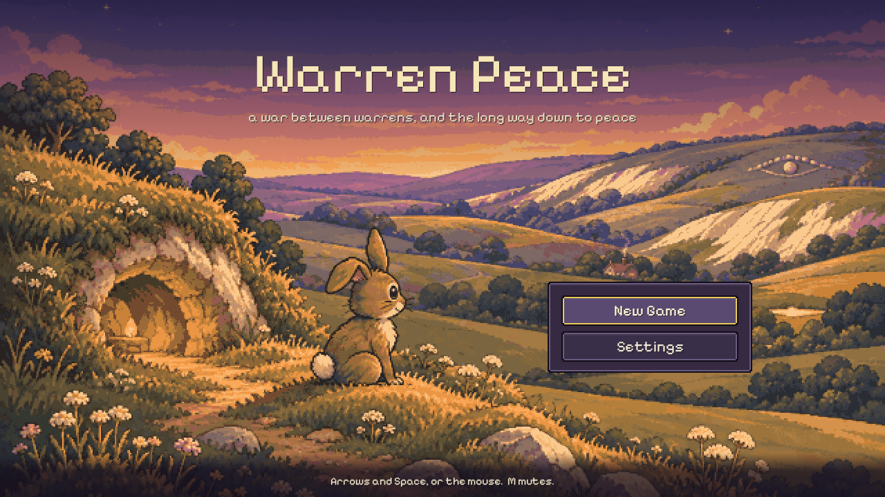
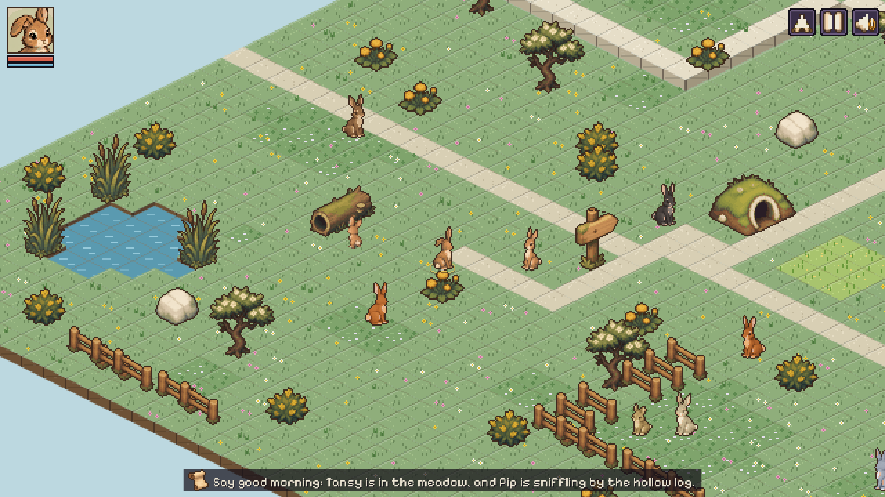
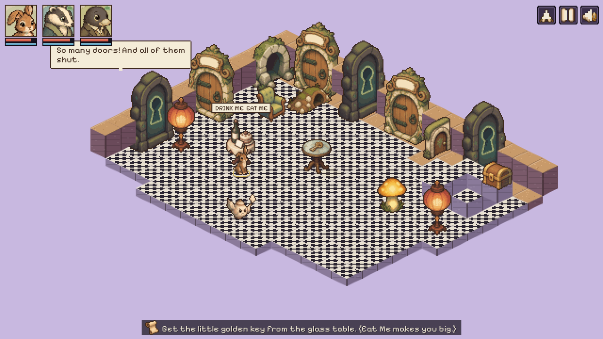
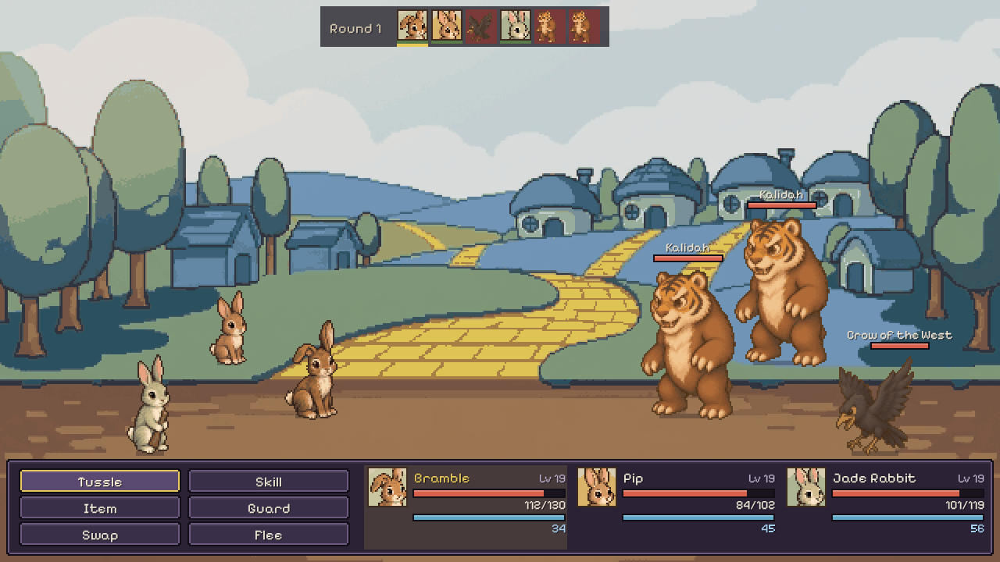
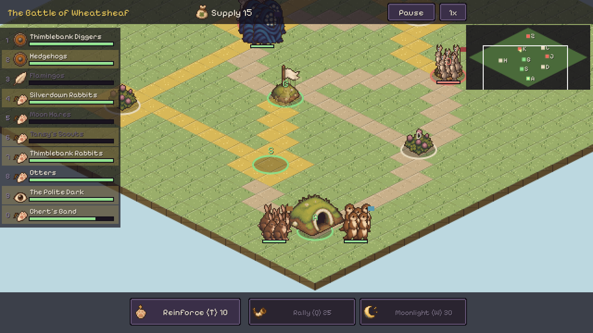
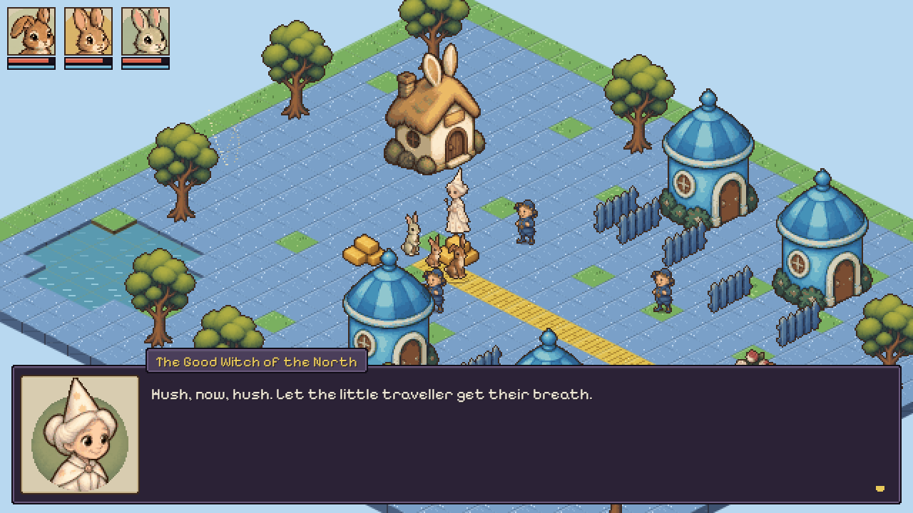
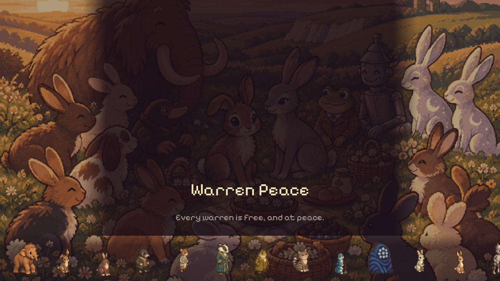

# Warren Peace

*A cozy rabbit adventure-RPG with a war that ends in peace.*

Your warren on Sorrel Down has been wrecked by maddened neighbours, and some of your friends have been carried off. Old Yarrow gives you the key to a door that was never meant to open. Down there, through the Depths, lie storybook worlds and stranger places still. Find friends, build an army, and free each warren in turn, until every rabbit on the downs stands together. And something very old is dreaming at the bottom of it all.

**[▶ Play Warren Peace](https://warrenpeace.synapticnoise.com/)** in your browser on a desktop or laptop. No install.

## The world

A big story adventure, three hours or more: a prologue on the downs, four chapters and a finale, with 15 friends who join your party and 25 squads who join your army.

| | |
|---|---|
|  **Sorrel Down and Thimblebank Warren.** Hop about, talk to everyone, nibble the clover. Then the raid comes. |  **Wonderland.** Eat Me, Drink Me, a Caucus-race, a mad tea-party and the Queen's croquet. Your friends tuck in when you change size. |
|  **Turn-based battles.** Every enemy shows its big move a turn ahead: Guard, cure, and use your friends' skills. |  **Army battles.** Take the nodes, hold your home, and win with a plan rather than fast clicking. |
|  **Oz, the Moon, the River Bank, the Centre of the Earth.** Old storybook places, all with their own warrens and their own trouble. |  **The Sleeping Deep.** What is humming under every warren, and how a war ends in peace. |

## After the ending

- **Epilogue: Digging the Other Way.** Shale from Flintcomb is waiting at the feast. Help Flintcomb dig new homes up and sideways into the downs: Rumble shoves the spoil heaps, Bramble thumps the walls to find the old rooms, a stubborn digger is talked round, and everyone sets the Top Stone. About 20 minutes, with no fighting.
- **Army battles again, against the clock.** The Lookout Stone lets you fight any of the five army battles with your whole post-game army, for the best time (counted in battle time from your first order). Beat Burdock's time, and go for gold.
- **New Game+.** Woodruff (or the title screen) will tell the story again from the start. Your friends keep their levels, ordinary fights are quick, and every boss has a harder second phase with something new to learn. Your finished save is kept safe in a slot.

## How to play

- **Hop:** arrow keys or WASD, or click a tile. Click a person, chest or door to walk up and use it.
- **Talk / use:** Space, Enter or E. **Nibble:** N.
- **Camp** (party, talk, gear, items, army, quests, map, bestiary): Tab or I.
- **Battles:** arrows and Space, or click a command and then a target. Escape goes back.
- **Army battles:** left-click (or 1-9, B for all) selects squads; right-click a node (or press its letter) to send them. T reinforces, Q W E R use army abilities, Space pauses, F speeds up.
- **Pause / settings / save:** Escape or P. **Mute:** M.

The game saves itself as you go between places and after battles, and has three save slots too. Losing a battle just sends you back to the door to try again.

## How it was made

Warren Peace was made by [Claude Code](https://claude.com/claude-code) with [gamegen](https://github.com/zeveck/gamegen), from this request:

> `/gamegen the game in rabbit-game.md --scope large --platform desktop --plan-only --out .`

where [rabbit-game.md](rabbit-game.md) is the full description. Then, on the budget:

> Oh, we can budget $50

> The budget is the least important part here.

Then, when building it, to have friends follow Bramble on the map:

> `/gamegen --continue have the two travelling companions follow Bramble on the map, with a back view for each companion and a code hop; they merge into Bramble in Wonderland's size puzzles, the shepherd sneak and the China Country`

Then, after it was finished, three additions (the epilogue, army battle revisits with best times, and New Game+):

> Do each of those three proposed changes and report when ready.

And while it was being built (twice after the container running it crashed):

> continue

> Be sure to use Opus 5.5 or even Sonnet 5.5 where you trust them to do a highly reliable job.

> `/gamegen --continue`

Then, to put it online:

> When the changes are all done, go ahead with /gamegen --publish.

Then, after it was online, to fix a flicker in the opening:

> `/gamegen --change What I take to be the town map kept flashing between rendering other scenes during the opening. I've seen that happen with other games a bit, so (1) we should fix it and (2) figure out what to file against gamegen so games know to avoid it -- making sure the opening screens render properly without flicker is critical to initial impressions.`

gamegen designed the game, had review agents polish the design, made the art, animation, music and sound with these plugins, built it chapter by chapter, and play-tested it, including full playthroughs from New Game to the ending:

- [imagegen2](https://github.com/zeveck/imagegen2): Bramble (the style anchor), the party with back views, about 400 figures, portraits, props, icons, the key art and the epilogue's closing picture.
- [nanogen](https://github.com/zeveck/nanogen): the painted battle backdrops and the mock screen.
- [anim8gen](https://github.com/zeveck/anim8gen): Bramble's hops, idle, nibble and thump, the raiders, the moths, the Cheshire Cat's vanishing and the Witch's melt.
- [audiogen](https://github.com/zeveck/audiogen): 30 music tracks, 43 sound effects, ambient loops, and the voice lines (Old Yarrow, the whisper in the Shallows, Ninefold).

The plan, the reviews and the build notes are in [design/](design/).

## Playing locally

Warren Peace is a plain web page with no build step. Serve the `game` folder with any static web server, for example:

    cd game
    python3 -m http.server 8000

then open http://localhost:8000. (Browsers won't run it from a double-clicked file.)

## Credits

An idea by Rich Conlan.

Font: [Pixelify Sans](https://fonts.google.com/specimen/Pixelify+Sans) by the Pixelify Sans Project Authors, under the SIL Open Font License (`game/fonts/OFL.txt`).
